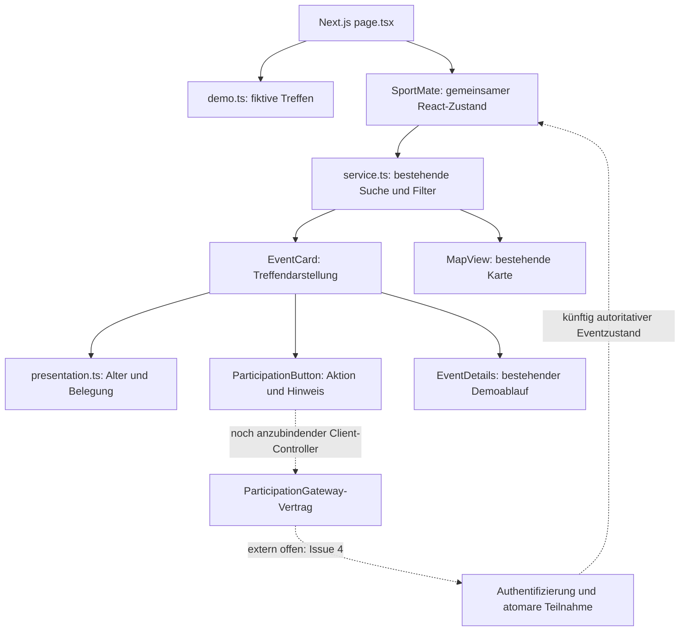
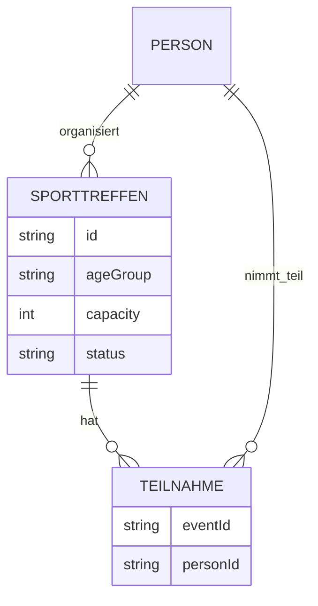

# Kundenfeedback 1 – Lukas, 22 Jahre

## Umfang und Verantwortung

Architektur und Entwurf: Systemstruktur, Datenmodell und Oberflächenentwurf einschließlich
Frontend-Integration und Tests. Quelle: Abschnitt Kundenfeedback 1 in
[Reales Feedback.docx](../Reales%20Feedback.docx). Sarah, Max und Tims Landingpage sind nicht
Gegenstand dieser Änderung. Keine Erweiterung von Erstellung, eigenen Treffen,
Teilnehmerverwaltung oder Kommunikation.

Die echte Next.js-Anwendung startet über `npm run dev -- --port 3010`.
[page.tsx](../../src/app/page.tsx) lädt weiterhin fiktive Treffen aus
[demo.ts](../../src/features/events/demo.ts). Der historische Klickprototyp bleibt unverändert.
Next.js-Frontend bedeutet hier noch keine produktive Teilnahmeplattform.

## Datenmodell und Darstellung (B/C)

[SportEvent](../../src/features/events/model.ts) bleibt kompatibel. Keine Migration,
keine Datenbankänderung und keine Änderung an den bestehenden Geschäftsregeln.

| Feld | Bedeutung und Darstellung |
|---|---|
| `ageGroup` | Vom Ersteller gewählte Altersgruppe des Treffens, keine Auswertung tatsächlicher Teilnehmeralter und keine serverseitig erzwungene Zugangsbeschränkung. `''` bedeutet alle Altersgruppen; fehlender/unbekannter Wert bedeutet „Nicht angegeben“. |
| `capacity` | Gesamtzahl der Plätze einschließlich organisierender Person im bestehenden Demomodell. |
| `participants` | Liste der in der Demo teilnehmenden Personen-IDs; keine produktiven Buchungsbelege. |
| freie Plätze | `capacity - participants.length`, ausschließlich bei gültiger Kapazität und vollständiger, eindeutiger Teilnehmerliste. |
| ungültige Belegung | Fehlende Liste, doppelte IDs, Überbelegung oder ungültige Kapazität ergeben „Platzangabe nicht verfügbar“ statt erfundener Verfügbarkeit. |
| abgesagt | „Abgesagt“, keine freien buchbaren Plätze suggerieren. |

[presentation.ts](../../src/features/events/presentation.ts) berechnet ausschließlich
Darstellungswerte. [EventCard.tsx](../../src/components/EventCard.tsx) zeigt Altersgruppe
und freie Plätze. Die Daten werden weder korrigiert noch mutiert.

Für eine spätere produktive Liste muss der Backend-Adapter einen autoritativen
Belegungsstand liefern. Eine aus Datenschutzgründen ausgeblendete Teilnehmerliste darf
niemals als leere Liste beziehungsweise null Belegungen interpretiert werden. Ein separates
Zählfeld in einem späteren API-Lesemodell ist mit Issue #4 abzustimmen; die UI erfindet es nicht.

## Teilnahmeoberfläche und externe Abhängigkeit (A)

[ParticipationButton](../../src/components/ParticipationButton.tsx) zeigt auf jeder Karte
„Jetzt teilnehmen“. Solange keine echte Anbindung existiert, ist die Aktion deaktiviert
und über `aria-describedby` mit einem sichtbaren Grund verbunden. Volle, abgesagte,
begonnene und in der Demo bereits gewählte Treffen erhalten passende Hinweise.
Die bestehenden Detaildialog-Demoaktionen bleiben unverändert und getrennt; der neue
Kartenbutton ruft sie nicht auf. Es gibt keinen Netzwerkaufruf und keine Erfolgssimulation.

[participation.ts](../../src/features/events/participation.ts) definiert den Vertrag
`ParticipationGateway.join(eventId)` und die UI-Zustände unavailable, ready, pending,
confirmed und error. Dieser Vertrag ist Architekturvorbereitung, kein vorhandener API-Endpunkt.

Noch zu liefern durch [Issue #4](https://github.com/renatuni/Software-Project-WS-2026-27/issues/4):

- Adapter mit echten Eventdaten und serverseitig geprüfter Sitzung; niemals die ausgewählte
  Demo-Person als authentifizierte Identität übertragen.
- Atomare, persistente und idempotente Teilnahme einschließlich Prüfung von Kapazität,
  Termin und Status. Erneuter Versuch nach Netzwerkfehler darf keinen zweiten Platz belegen.
- `confirmed` mit autoritativem Treffen erst nach erfolgreicher Speicherung; fachliche
  Ablehnungen `unauthenticated`, `full`, `inactive`, `unavailable`; Transportfehler abfangen.
- Ein Client-Controller verbindet ready → pending → confirmed/error. Während pending keine
  weitere Anfrage; Erfolg aktualisiert den gemeinsamen Eventzustand aus der Serverantwort.
  Bei Ablehnung/Fehler keine lokale Teilnehmererhöhung. Bei voller Belegung Daten nachladen.
- Authentifizierung, HTTP/RPC-Route, Datenschutz-Lesemodell und Datenbankrechte separat
  abstimmen. Der Vertrag legt bewusst noch keinen erfundenen Endpoint fest.

Die reine Buttonkomponente kann diese Zustände darstellen. Die reale Anwendung verwendet
absichtlich nur unavailable; Controller, Adapter und produktive Ende-zu-Ende-Prüfung bleiben
offen. Das ist eine fertige Oberfläche mit offener Integration, keine fertige Teilnahmefunktion.

## Komponentenstruktur

Das ER-Diagramm beschreibt die fachliche Beziehung. In der aktuellen Demo ist TEILNAHME
als `SportEvent.participants` eingebettet, nicht als Datenbanktabelle umgesetzt.
Eine Kombination aus Event und Person muss produktiv eindeutig sein; Umsetzung und
Nebenläufigkeit gehören zu Issue #4. Keine SQL-Schemaänderung in diesem Feedbackpaket.

## Prüfung

Unit-Tests prüfen Altersgruppen, freie/volle/abgesagte Treffen und unvollständige oder
widersprüchliche Belegung. Playwright prüft die echte Next.js-Seite auf Desktop und 360 px.
Die bestehenden Kernabläufe werden als Regressionstests beibehalten.
